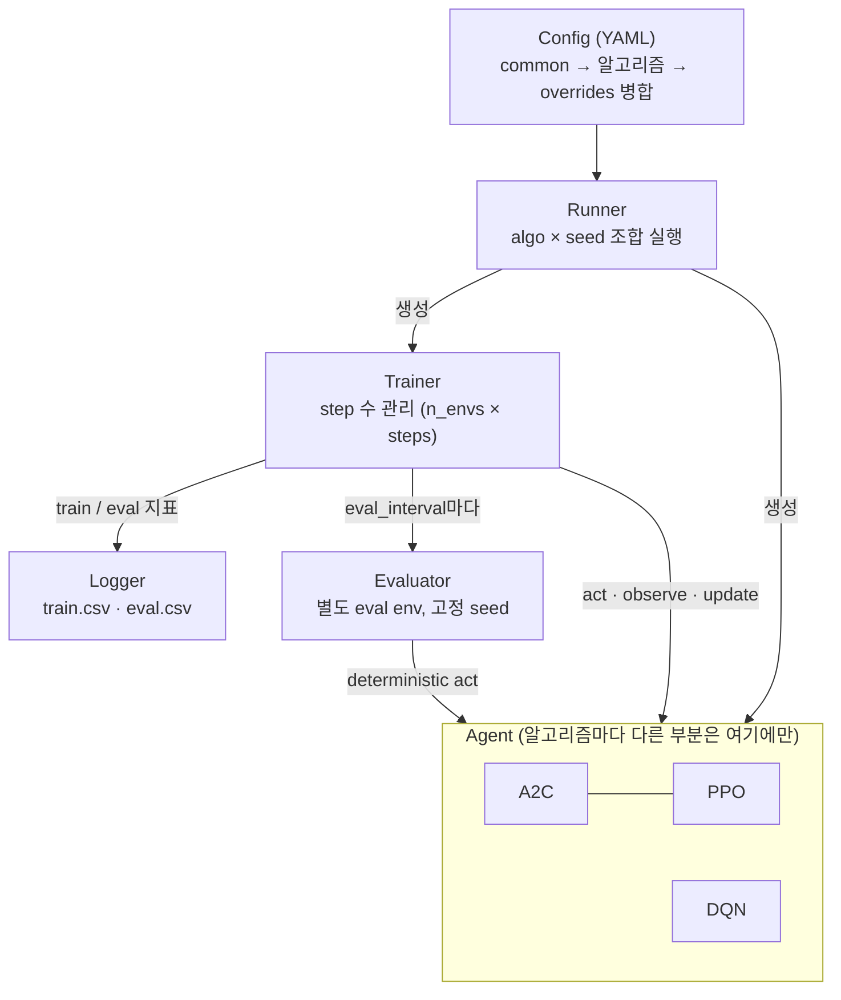

## EvalRL

강화학습 알고리즘을 공부하면서 구현도 병행하였습니다. 그 과정에서 알고리즘의 성능을 비교하고 싶어졌습니다.
그러나 알고리즘의 성능을 공정하게 비교하기 위해서는 시드, 총 타임스텝 등 여러가지 조건을 동일하게 해야했습니다.
제가 각각의 알고리즘과 평가를 구현하는 것은 이런 일관성을 지키기 힘들었기 때문에
[evalrl](https://github.com/jihoAi/evalrl)이라는 프레임워크를 만들어서 비교하였습니다.

### 프레임워크 구성

알고리즘들만 직접 구현하고 나머지 trainer,runner,evaluator등은 공통된 코드로 돌릴 수 있도록 구현하였습니다.

### 평가

평가지표는 다음과 같습니다.

- 학습 곡선 : seed 평균 + 95% 신뢰구간표시
- 표본 효율 : 학습 곡선 아래 면적을 구합니다(AUC)
- 최종 성능 : 마지막 몇 번의 평가를 IQM으로 요약합니다.
