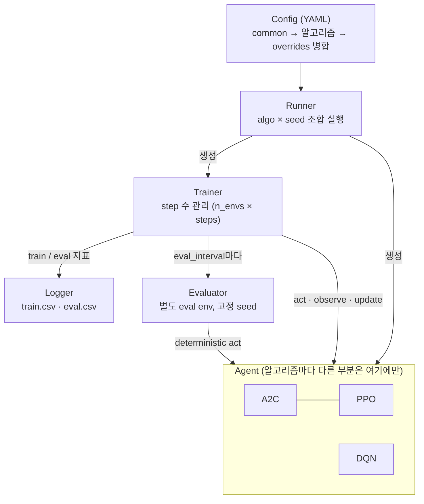

## EvalRL

강화학습 알고리즘을 공부하면서 구현도 병행하였습니다. 그 과정에서 알고리즘의 성능을 비교하고 싶어졌습니다.
그러나 알고리즘의 성능을 공정하게 비교하기 위해서는 시드, 총 타임스텝 등 여러가지 조건을 동일하게 해야했습니다.
직접 각각의 알고리즘과 평가를 구현하는 것은 이런 일관성을 지키기 힘들었기 때문에 [evalrl](https://github.com/jihoAi/evalrl)이라는 프레임워크를 만들어서 비교하였습니다.

처음에는 완전히 같은 조건에서 비교를 하려고 하였지만 각각 알고리즘에 필요한 하이퍼파라미터가 다르기 때문에 타임스텝과 시드, 네트워크구조, 평가 방식을 같게 하였습니다.

### 프레임워크 구성

알고리즘들만 직접 구현하고 나머지 trainer,runner,evaluator등은 공통된 코드로 돌릴 수 있도록 구현하였습니다.

### 알고리즘 구현

모든 알고리즘은 추상 클래스 `Agent`를 상속하고, 아래 4개 메서드만 구현합니다. Trainer는 이 메서드들만 호출하므로 알고리즘이 무엇인지 몰라도 같은 학습 루프를 돌 수 있습니다.

| 메서드 | 역할 |
| --- | --- |
| `act(obs, deterministic)` | 행동 선택 (평가 시 `deterministic=True`) |
| `observe(obs, next_obs, acts, rewards, terms, truncs)` | 환경이 준 transition을 버퍼에 저장 |
| `ready_to_update()` | 지금 업데이트할 차례인지 판단 |
| `update()` | 학습 1회 수행, loss 등 지표 반환 |

알고리즘별로는 이 메서드를 채우는 방식만 다릅니다.

| 메서드 | A2C | PPO | DQN |
| --- | --- | --- | --- |
| `act` | 정책에서 샘플링 | A2C와 같음 | ε-greedy |
| `observe` | rollout buffer에 저장 | A2C와 같음 | replay buffer에 저장 |
| `ready_to_update` | n-step rollout이 찼을 때 | A2C와 같음 | `learning_starts` 이후 `train_freq` step마다 |
| `update` | gradient step 1회 | 같은 rollout으로 여러 epoch × minibatch | TD 학습 + target network 동기화 |

PPO는 A2C를 상속하고 `update`만 바꿨습니다. `save`/`load`, step 수 관리(`on_step`)는 베이스 클래스에 공통으로 구현해 두었습니다.

### 평가지표

평가지표는 다음과 같습니다.

- 학습 곡선 : seed 평균 + 95% 신뢰구간표시
- 표본 효율 : 학습 곡선 아래 면적을 구합니다(AUC)
- 최종 성능 : 마지막 몇 번의 평가를 IQM으로 요약합니다.

## 예고

다음 글에서 DQN, A2C, PPO를 LunarLander-v3에서 학습시키고 그 결과를 비교해보겠습니다.
